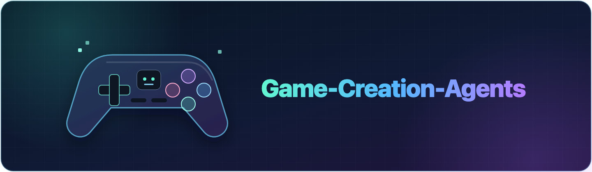
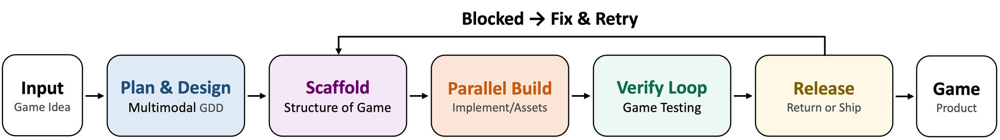

<div align="center">



### 🎮 Specialized agents turn your game idea into a playable, verified experience.


[](gca-mcp/pyproject.toml)
[](scripts/preflight-requirements.toml)
[](https://phaser.io/)
[](gca-mcp/README.md#tools)
[](LICENSE)

</div>

# 💡 Introduction

Game-Creation-Agents (GCA) is an end-to-end pipeline that turns a
natural-language idea into a playable, verified browser game. Claude
Code coordinates specialized agents for design, authored levels, scaffolding,
implementation, assets, integration, verification, and critique.
The complete creation flow is:

<div align="center">
  
</div>

---

# 📰 News

- **[2026-07-16]** We are pleased to announce the initial public release of
  **Game-Creation-Agents (GCA)**, an end-to-end agentic pipeline for designing,
  building, and verifying playable browser games.

---

# 🚀 Quick Start

## 🧰 1. Environment

Requirements:

- macOS or Linux; Windows users should use WSL2;
- Python 3.11 or newer;
- [`uv`](https://docs.astral.sh/uv/);
- Node.js 20 or newer and npm;
- Playwright with Chromium;
- `curl`, `ffmpeg`, and `ffprobe`;
- Claude Code with project MCP support;
- an OpenAI API key for image generation and editing;
- a Volcengine ARK API key for Seedance video generation and Doubao VLM;
- an optional deployed [RMBG-2.0 matting service](services/README.md) for
  soft-alpha edges. The default `assets.matting.backend: auto` falls back to
  deterministic color-key matting during network, missing-route HTTP 404, or
  HTTP 5xx outages and remembers one probe result per endpoint for the
  lifetime of the MCP process.

The current preflight checks provider credentials, the configured RMBG/color-key
matting routes, browser, media, and filesystem dependencies required by the full pipeline.
Seedance sends local input frames inline, so object storage is not required.
Host binary requirements and the minimum Node.js version are declared in
[`scripts/preflight-requirements.toml`](scripts/preflight-requirements.toml).

**Install system prerequisites**

On macOS, install [Homebrew](https://brew.sh/) first, then:

```bash
brew install git uv node ffmpeg python@3.11
npm install -g @anthropic-ai/claude-code playwright
npx playwright install chromium
```

On Ubuntu / Debian:

```bash
sudo apt-get update
sudo apt-get install -y git curl ffmpeg
```

Then install [`uv`](https://docs.astral.sh/uv/getting-started/installation/),
[Node.js 20+](https://nodejs.org/en/download), and
[Python 3.11+](https://www.python.org/downloads/) from their official or
distribution-supported sources. Install the Node tools:

```bash
npm install -g @anthropic-ai/claude-code playwright
npx playwright install --with-deps chromium
```

Confirm the active executables:

```bash
python3 --version  # must be 3.11+
node --version     # must be 20+
uv --version
ffmpeg -version
ffprobe -version
```

The global Playwright installation reflects the current runner loader. It is a
known pre-release limitation; a reproducible release must replace it with a
versioned local dependency.

**Clone and install GCA**

```bash
git clone https://github.com/harnessRL/gca.git
cd gca

cd gca-mcp
uv sync --extra dev
cd ..
```

## 🔑 2. Configure credentials

```bash
cp .env.example .env
```

The root `.env` file is loaded automatically by `gca-mcp`. Replace every
uncommented placeholder:

| Capability | Settings | Purpose |
|---|---|---|
| Image generation | `OPENAI_API_KEY`, `GAME_ASSET_BASE_URL`, `GAME_ASSET_MODEL` | Generate and edit assets with the OpenAI Images API |
| Seedance video | `ARK_API_KEY`, `SEEDANCE_URL`, `SEEDANCE_MODEL_STANDARD`, `SEEDANCE_MODEL_FAST` | Generate videos through Volcengine ARK |
| Video understanding | `DOUBAO_API_ENDPOINT`, `DOUBAO_MODEL` | Route the pinned Doubao 2.0 model through ARK |
| Background removal | `RMBG_BASE_URL`, optional `HF_TOKEN` | Connect to the [RMBG-2.0 matting service](services/README.md) for image and video matting. `HF_TOKEN` is only read when in-process matting downloads model weights from a gated Hugging Face repository |

The OpenAI and ARK endpoints and model IDs in `.env.example` are provider
defaults, so most users only need to supply their API keys. The VLM policy
accepts only `doubao-seed-2-0-pro-260215`, with one request attempt per call.
`DOUBAO_MODEL` is pinned at runtime and is not user-configurable. Seedance
accepts local frames inline, so no object storage is required.

Store credential files securely and never commit `.env` or service-account JSON.

### Video understanding requires an ARK key

Verification is not optional-degradable: the VLM identity is pinned to Doubao
2.0 and there is no alternate provider chain. Without a working `ARK_API_KEY`,
screenshot and gameplay-video analysis fail rather than skip, which blocks the
verify phase of the pipeline. ARK keys are issued for the Volcengine
`cn-beijing` region; obtain one before running a full pipeline.

Restart the MCP server after changing `.env`, since it is read at startup.

### Background removal without a service

`RMBG_BASE_URL` is optional. Left empty, public mode mattes in-process with
RMBG-2.0, which needs the extra:

```bash
cd gca-mcp && uv sync --extra local-rmbg --extra dev
```

Install this before the first asset run. `assets.matting.backend: auto` falls
back to color-key for transient service faults only; a missing torch install is
a dependency error and fails the call instead. The first matte downloads model
weights (about 90s), then settles near 8s per image on Apple Silicon. To skip
the dependency entirely, set `assets.matting.backend: color_key` in
`gca.config.yaml` and accept hard edges.

## 🤖 3. Generate a game with Claude Code

Start Claude Code from the repository root:

```bash
claude
```

Choose either input style:

### 💬 Option A — Describe the game directly

```console
> Create a compact top-down arena game where a lighthouse keeper defends the beacon from shadow creatures. Use responsive controls and a short boss wave.
```

### 📄 Option B — Use a Markdown game brief

Create `game-brief.md` in the repository root:

```markdown
# Lighthouse Keeper

## Game
A compact top-down arena-defense game.

## Core loop
Protect the beacon from escalating shadow waves with responsive movement and
attacks. End the session with a short boss wave.

## Style
Moody coastal fantasy, readable combat, and a compact play session.
```

Then ask Claude Code:

```text
Create the game described in @game-brief.md.
```

Both options load GCA, run the required environment preflight, generate the
game, and continue through verification automatically.

## 🕹️ 4. Preview the result

### 📁 Generated workspace

Each game is written to its own workspace:

```text
playground/<game-slug>/
├── PROMPT.md                     # Original game request
├── GAME_DESIGN.md                # Design and gameplay contracts
├── index.html                    # Browser entry point
├── package.json
├── src/                          # Phaser scenes and game logic
├── assets/
│   └── asset-manifest.json       # Runtime asset registry
├── levels/                       # Present for authored level models
└── .playtest/
    ├── state.json                # Current pipeline state
    ├── resume.json               # Recovery information
    ├── tests/                    # Test results
    └── verify/                   # Verification evidence and gates
```

### 🌐 Start the preview

Run the server from the repository root:

```bash
python3 scripts/serve_game.py playground/<game-slug> --base 3000
```

The launcher stops this game's previous server, selects the first available port
starting at `3000`, verifies that it is serving the requested workspace, and
prints the exact browser URL:

```text
URL=http://127.0.0.1:<port>
```

Open that URL to play the generated game.

### 🛑 Stop the preview

```bash
python3 scripts/serve_game.py playground/<game-slug> --stop
```

The preview server is for manual inspection. Canonical tests and release
evidence are produced by the GCA verification pipeline.

---

# 🙏 Acknowledgement

GCA builds on the following core platforms:

| Project | Role in GCA |
|---|---|
| [Claude Code](https://code.claude.com/docs) | Loads the game-pipeline Skill and coordinates the specialized agents |
| [Phaser](https://phaser.io/) | Runs each generated game in the browser |
| [RMBG-2.0](https://huggingface.co/briaai/RMBG-2.0) | Removes backgrounds from generated images and animation frames |

We thank their maintainers and contributors for the foundations that make this
pipeline possible. We also thank
[OpenGame](https://github.com/leigest519/OpenGame) for serving as a design
reference for GCA.

---

# ⚖️ License

The Game-Creation-Agents pipeline is licensed under the
[Apache License 2.0](LICENSE). This covers the repository source code, agent
definitions, Skills, scripts, configuration, and documentation unless stated
otherwise.

Third-party dependencies, supplied assets, and generated outputs remain subject
to their respective licenses and usage terms.

# 📚 Citation

If you find GCA helpful, please cite:

```bibtex
@techreport{gca2026,
  title       = {{Game-Creation-Agents: Autonomous Game Production}},
  author      = {{Multimodal Reinforcement Learning Team, Tencent}},
  institution = {Tencent},
  year        = {2026},
  url         = {https://github.com/harnessRL/gca}
}
```
